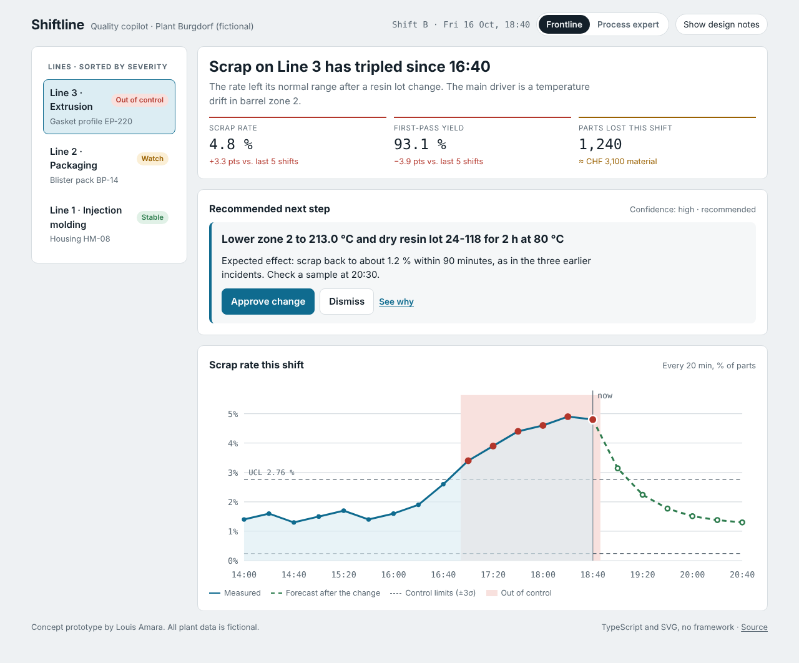
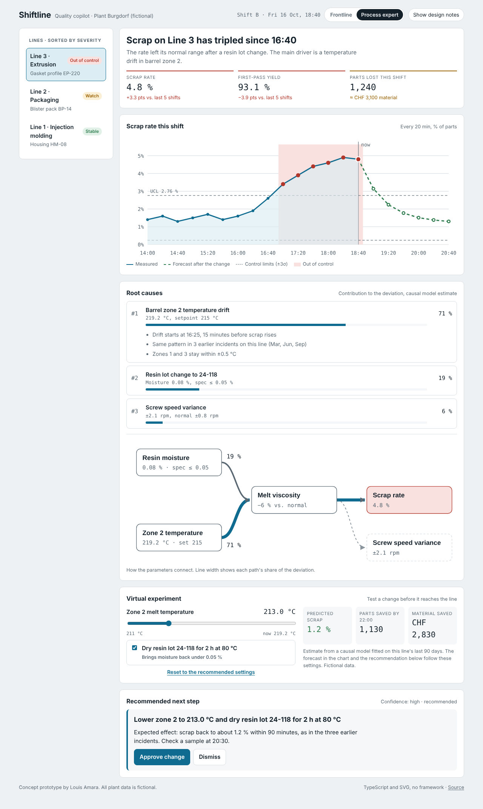

# Shiftline – AI quality copilot (concept prototype)

[](https://github.com/xloui99x/shiftline/actions/workflows/ci.yml)

When scrap starts rising on a production line, the shift lead needs three
answers fast: **what changed, why, and what to do**. Shiftline is my concept
for that moment: an interface that turns an AI root-cause analysis into a
decision a person can check and approve in under a minute.

**Live demo:** https://xloui99x.github.io/shiftline/ · all plant data is fictional



## The idea

The same incident is shown at **two depths**:

| Frontline (shift lead)            | Process expert                                               |
| --------------------------------- | ------------------------------------------------------------ |
| One-sentence headline, three KPIs | Ranked root causes with evidence                             |
| The recommended step comes first  | Causal graph of the parameters                               |
| Approve, or dismiss with a reason | Virtual experiment: test a setpoint before touching the line |

Design principles, also shown in the app via **Show design notes**:

1. **Worst line first.** Lines are sorted by severity; status is a word _and_ a
   colour, so it reads for colour-blind people and on a dim shop-floor screen.
2. **One sentence before any number.**
3. **Show the reasoning.** Causes are ranked by contribution and each opens its
   evidence. People act on AI output when they can check it.
4. **Expected outcome, visible.** The control chart shows ±3σ limits and a
   forecast of what the recommended change should do.
5. **Try before you change the line.** The experiment updates prediction,
   savings, forecast and recommendation together.
6. **A person always approves.** Dismissing asks why, so the model can learn.



## How it is built

TypeScript and SVG, **no UI framework**: the app is small enough that plain DOM
code stays readable, and the bundle is under 20 kB.

```
src/
├── data/            typed fictional plant: lines, readings, causes, causal graphs
├── domain/          pure logic, unit-tested
│   ├── model.ts            process model, forecast, savings, control limits
│   └── recommendation.ts   next step derived from the current settings
├── ui/              pure markup builders, tested without a browser
│   ├── chart.ts            Shewhart control chart with forecast and tooltips
│   ├── causalGraph.ts      left-to-right graph, edge width = causal share
│   └── views.ts            rail, KPIs, causes, experiment, action
└── app.ts           state, rendering and delegated event handling
```

- **Model.** Scrap is modelled as a parabola around the optimal melt
  temperature plus a penalty for wet resin; the forecast approaches the
  predicted level exponentially. It stands in for a causal model fitted on
  line history and is deliberately simple to inspect.
- **Rendering.** Chart and graph are generated as SVG strings from data, so
  they scale crisply and can be unit-tested by parsing the markup. All text is
  escaped before it enters a template.
- **One source of truth.** The chart forecast, the savings and the
  recommendation are all computed from the same experiment settings, so they
  can never disagree.
- **Accessibility.** Real buttons, `aria-pressed`/`aria-expanded`/`aria-selected`,
  a live region for the headline, visible focus, dark mode and
  `prefers-reduced-motion`.

## Development

```bash
npm install
npm run dev     # http://localhost:5173
npm test        # 33 tests: model, rendering and full UI flows (Vitest, jsdom, Testing Library)
npm run lint    # ESLint with strict type-aware rules
npm run build
```

CI runs formatting, lint, tests and the build on every push; pushes to `main`
deploy to GitHub Pages.

## Status

A self-initiated concept prototype (October 2026): concept, flows, interaction
design and copy by me, built together with an AI coding assistant. It explores
the interaction design, not a production integration: there is no connection to real machine
data, and the numbers are invented but kept realistic.
